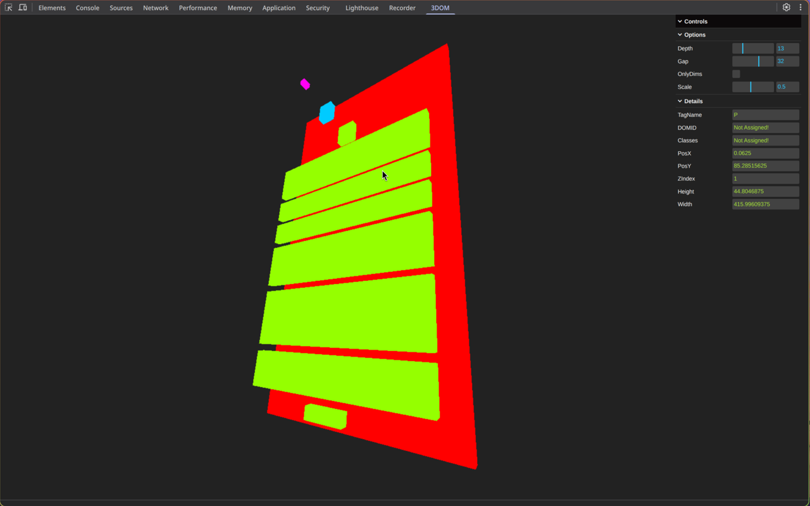
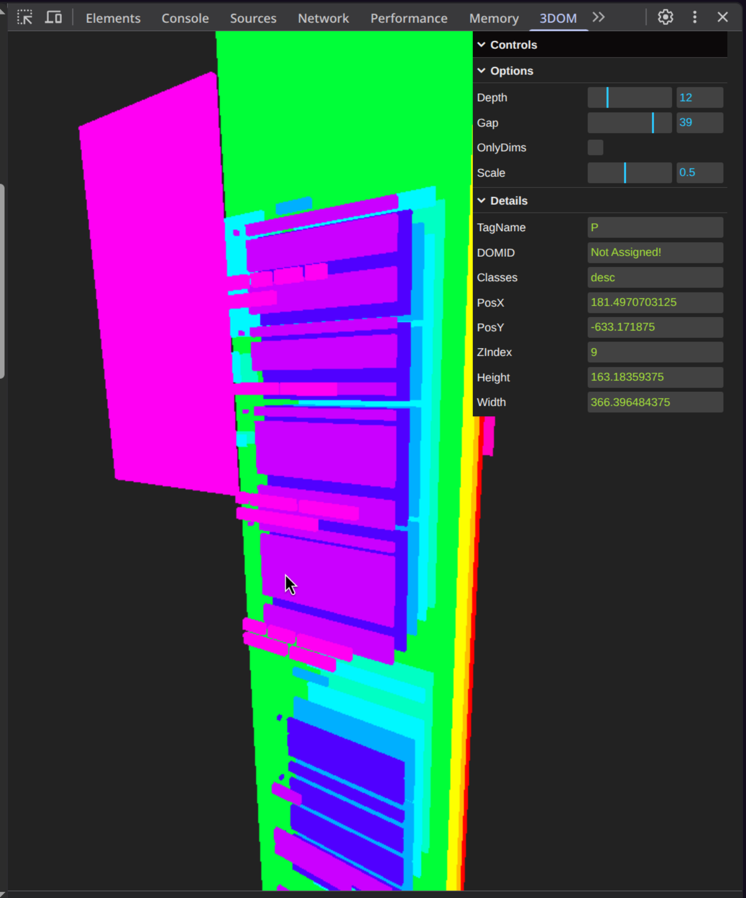
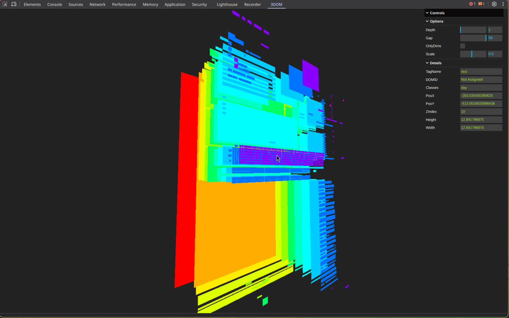

# 3DOM
> A Chrome Devtools extension for inspecting and rendering WebGL 3D DOM hierarchies in real time.

## Overview

3DOM bridges the gap between traditional web debugging and 3D graphics rendering. By injecting directly into Chrome DevTools, it allows developers to visualise and inspect DOM trees and WebGL hierarchies as 3D structures, making spatial debugging intuitive and efficient.

## Key Features

* **Live 3D inspection:** Render and navigate complex DOM hierarchies in an interactive 3D viewport.
* **DevTools Integration:** Seamlessly embeds right into your browser's developer tools panel.
* **Real-Time Sync:** Highlights and updates node states dynamically as the underlying DOM changes.
* **Optimized Performance:** Built with Three.js and TypeScript for smooth rendering and strict type safety.

## Tech Stack

* **Core:** TypeScript
* **Rendering Engine:** Three.js / WebGL
* **Extension API:** Chrome DevTools Extension API

## Installation

### Chrome Web Store (Recommended)
Install directly from the [Chrome Web Store](https://chromewebstore.google.com/detail/3dom/hpacmboaaglophhdpihgedncgmjmjigi)

### Source Build

1. **Install prerequisites**
* You will need a **chromium based** browser and node preinstalled in your system to continue

2. **Clone the repository**
```bash
git clone https://github.com/nkminion/3DOM.git
cd 3DOM
```

3. **Install dependencies**
```bash
npm install
```

4. **Build the extension**
```bash
npm build vite
```

5. **Load into Chrome**
* Navigate to ``chrome://extensions/``
* Enable **Developer Mode**
* Click **Load Unpacked** and select the generated ``/dist`` directory

## Usage
* Open your target webpage in Chrome.
* Open **Chrome DevTools**.
* Navigate to the **3DOM** tab in the top panel and refresh the page to start.

## Controls
* Left-Mouse Button: Orbit
* Scroll Button: Zoom
* Right-Mouse Button: Pan

## Screenshots






## License
Distributed under the MIT License. See [LICENSE](LICENSE) for more information.
